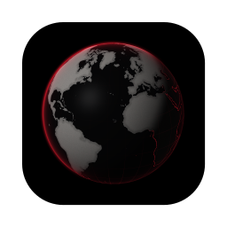

<p align="center">
  
</p>

<h1 align="center">gestyq</h1>

<p align="center">
  <b>your hands and head, in control.</b><br>
  drive your mac with your webcam: move, click, scroll, switch spaces and write, without touching a thing.
</p>

<p align="center">
  macos 12+ · apple silicon · runs 100% on-device · v0.3
</p>

---

## why

your trackpad is great until your hands are full, far away, or tired. gestyq turns the camera you already have
into a second input device. point to move, pinch to click, flick to change spaces, turn your head to switch
apps. it lives in your menu bar and stays out of the way until you need it.

## what it does

- **a real cursor, from your hand.** works like a mouse: move your hand, the cursor follows. slow is precise,
  fast crosses the screen. take your hand away and it stays where it was.
- **click, drag, scroll.** pinch to click, pinch twice to double click, make a fist to drag, raise two fingers
  to scroll.
- **flick between spaces.** a quick flick of either hand, like waving a fly away, slides to the next desktop
  or full-screen app.
- **window moves with both palms.** spread them to maximize, bring them together to minimize, move them left
  or right to tile.
- **head gestures.** turn your head and back to switch apps.
- **write in the air.** click into any text box and a black canvas appears. point and draw capital letters;
  they're typed for you.
- **make it yours.** every gesture can do any of 30+ actions. pick them in the app window, with a live view of
  what the camera sees.
- **made for real desks.** multiple displays, sitting far back, a phone camera nearby, resting your chin on
  your hand: gestyq copes with all of it.

## private by design

the camera feed never leaves your mac. hand and face tracking run locally with google's mediapipe models; there's
no account, no cloud and no analytics. turn gestyq off and the camera is off. the light goes out, every time.

## get started

gestyq is built from source for now (a signed download is on the way).

```bash
git clone https://github.com/bassem-1/gestyq.git
cd gestyq
pip install -r requirements.txt      # python 3.11
scripts/bundle.sh                    # builds and installs /Applications/gestyq.app
open /Applications/gestyq.app
```

then:

1. **allow the camera** when macos asks.
2. **allow accessibility** so gestyq can move and click: click the globe in the menu bar → `grant access`, and
   switch gestyq on under system settings → privacy & security → accessibility.
3. **turn it on** with the switch in the menu bar, or by clicking the desktop gadget.

gestyq starts switched off, every time.

## gestures

| do this | it does |
|---|---|
| move your right hand | move the cursor |
| pinch thumb and index | click (twice = double click) |
| make a fist and move | drag |
| left hand: two fingers up, move up or down | scroll |
| left hand: pinch | right click |
| flick either hand sideways | next / previous space |
| both palms: spread · together · move sideways | maximize · minimize · tile left or right |
| turn your head and back | next / previous app |

all of these are defaults. change any of them in the app window.

## writing in the air

1. click into a text box: a small black canvas appears next to it.
2. **point** with your index finger and draw a capital letter.
3. hold still for half a second and it's typed.

flick your open hand right for a space, left to delete. draw down-then-left for enter. it's still learning:
expect most letters to land, and the occasional U read as V.

## faq

**the cursor moves but clicks don't work.**
accessibility is off for gestyq. this happens after a rebuild: remove gestyq from the accessibility list, click
`grant access` in the menu bar and switch it on again.

**it's using my iphone instead of the built-in camera.**
pick the camera in the app window (under the live view). gestyq picks cameras by device, so a phone that comes
and goes can't steal the slot.

**my hands get tracked while i'm resting my chin on them.**
a still hand on your face or head is ignored. move it away from your face and it counts again.

**can i keep the gadget on my desktop after quitting?**
yes, it stays by default and says "click to start". switch `gadget after quit` off in the window to remove it.

## roadmap

- signed, notarised download
- teach gestyq your own handwriting, lowercase and digits
- per-app gesture sets

## build on it

architecture, every tuning key and the diagnostic tools are in [docs/DEVELOPMENT.md](docs/DEVELOPMENT.md).
tests: `python -m pytest tests`.

<p align="center"><sub>part of a small family of quiet mac utilities, alongside haptyq and arriq.</sub></p>
